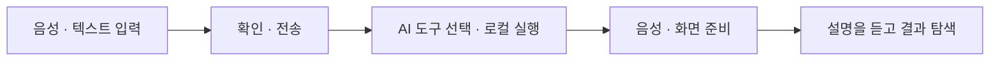

# NERVIS

**말로 시작하고, 소리와 화면으로 데이터를 탐색하는 AI 인터페이스.**

NERVIS는 **일상 브리핑과 뇌 데이터 탐색을 하나의 대화로 연결**합니다. 질문에 맞는 도구를 실행하고, 결과를 음성·3D 뇌 모형·MRI·시계열로 보여줍니다. 입자 코어는 대화 상태와 응답 음량에 반응합니다.

메뉴와 수치를 찾아가는 대신, 질문으로 분석을 시작하고 결과를 듣고 살펴보는 경험을 만듭니다. 일정을 확인하던 대화에서 뇌 분석으로 이어갈 수 있고, 분석 후에는 화면을 직접 조작하며 탐색할 수 있습니다.

## 주요 기능

| 기능 | 경험 | 질문 예시 |
| --- | --- | --- |
| 음성 대화 | 박수 두 번으로 시작 · HEY NERVIS로 받아쓰기 · 텍스트 입력 지원 | “오늘 일정 알려줘.” |
| 일상 브리핑 | 날씨·수업·할 일 조회, 할 일 관리와 수업 등록 | “오늘 할 일 알려줘.” |
| 뇌 데이터 분석 | 영역 비교·상관관계 검색·구간별 변화 탐색 | “상관관계가 가장 높은 두 영역을 찾아 줘.” |
| 결과 탐색 | 음성 설명과 3D·MRI·파형·계산 결과, 영역·시점·재생 구간 조작 | “좌우 전전두피질을 비교해 줘.” |

## 대화에서 탐색까지



받아쓴 문장은 자동 전송하지 않습니다. 내용을 확인하고 보내면 응답 음성을 준비한 뒤 브리핑 카드나 분석 화면으로 연결합니다.

**AI는 요청을 해석하고 도구를 선택하며, 뇌 데이터 계산은 Python이 로컬에서 수행합니다.** 설명은 계산 결과의 요약 근거를 바탕으로 생성합니다. 화면에 표시하는 수치와 파형도 실제 로컬 결과를 사용합니다.

## 분석 화면

| 구성 | 살펴볼 수 있는 내용 |
| --- | --- |
| 3D 뇌 모형 | 선택 영역의 위치와 신호 크기에 따른 밝기 변화, 회전·확대·시점 전환 |
| MRI | Axial·Coronal 단면, 선택 영역 마스크와 좌우 영역 확대 |
| 시계열 | 두 영역의 표준화 신호, 샘플 재생과 구간별 상관관계 |
| 응답·계산 결과 | AI 설명, Pearson·Spearman 상관계수, 영역의 두께·부피 비교 |

상관관계가 높은 영역을 검색하거나 특정 구간을 비교할 수 있습니다. 상세 분석은 이동 창, 신호 통계, 자기상관, 주파수와 PCA 요약으로 확장됩니다.

## 기술 구성

| 화면 | 분석·API | AI·음성 | 저장소 |
| --- | --- | --- | --- |
| React · TypeScript | Python · FastAPI | BAZE/HAI GPT | PostgreSQL |
| Three.js · React Three Fiber | NumPy · SciPy | 로컬 Whisper Turbo STT · ElevenLabs TTS | Docker Compose |

## 실행하기

**Windows · Python 3.11 · Node.js 22.20 · Docker Desktop**을 사용합니다. 이 저장소는 실행 코드를 제공하며, **실제 뇌 데이터·STT 모델·안내 음성은 별도로 준비해야 합니다.**

<details>
<summary><strong>설치 · 환경 설정 · 서버 실행</strong></summary>

### 1. 설치

프로젝트 루트에서 실행합니다.

```powershell
python -m venv .venv
.venv\Scripts\python.exe -m pip install -r requirements.txt
npm.cmd --prefix frontend ci
```

### 2. 설정

[.env.example](.env.example)을 `.env`로 복사하고 아래 값을 입력합니다. 기존 `.env`는 덮어쓰지 않습니다. 백엔드와 Docker Compose 모두 **이 파일 하나**를 사용합니다.

| 항목 | 환경 변수 |
| --- | --- |
| AI | `BAZE_API_KEY`, `NERVIS_LLM_MODEL`, `NERVIS_AI_ENABLED=true` |
| DB | `NERVIS_DB_PASSWORD`, `NERVIS_DB_PORT` |
| 날씨 | `NERVIS_KMA_API_KEY`, `NERVIS_WEATHER_LOCATION` |
| 음성 | `NERVIS_TTS_BACKEND=elevenlabs`, `ELEVENLABS_API_KEY`, `ELEVENLABS_MODEL_ID`, `ELEVENLABS_VOICE_ID` |

외부 AI·TTS 사용에는 API 권한과 크레딧이 필요합니다. TTS는 설정으로 HAI GPT 또는 VoiceStudio로 교체할 수 있습니다.

| 로컬 자료 | 준비 위치 |
| --- | --- |
| 뇌 데이터 패키지 | `data/processed/nervis_v1/` · [가공 코드](scripts/prepare_app_data.py) |
| 고정 안내 음성 | `frontend/public/audio/cues/` · [현재 파일명 설정](frontend/src/features/activation/fixedCues.ts) |
| STT 모델·GPU 라이브러리 | 기존 VoiceStudio의 Whisper Turbo 캐시·CUDA 설치 파일 재사용 |

STT는 설치된 Whisper large-v3 Turbo를 읽고 자동 다운로드하지 않습니다. 안내 음성은 시작·호출·접수 멘트이며, AI 응답 TTS와 구분됩니다.

### 3. 실행

**터미널 1 — DB·백엔드**

```powershell
docker compose up -d --wait
.venv\Scripts\python.exe -m backend
```

**터미널 2 — 프런트**

```powershell
npm.cmd --prefix frontend run dev
```

**http://localhost:5173/**에 접속합니다. DB는 기존 볼륨을 재사용하며 일정과 대화 기록을 유지합니다.

앱 서버는 각 터미널에서 Ctrl+C로 종료합니다. DB도 중지하려면 `docker compose stop`을 사용합니다.

</details>

## 프로젝트 구조

| 경로 | 역할 |
| --- | --- |
| `backend/` | 분석·AI·일정·대화·음성·날씨 API |
| `frontend/src/features/` | 시작 활성화·대화·브리핑·분석·음성 기능 |
| `frontend/src/components/` · `styles/` · `assets/` | 공통 화면·스타일·모델 자산 |
| `scripts/` · `database/` | 데이터 가공 도구·DB 마이그레이션 |

## 데이터와 출처

- **데이터 보호** — 원본은 읽기 전용으로 보관하고 별도 패키지로 분석합니다. 원시 영상·전체 시계열은 외부 AI에 보내지 않으며, 허용된 요약 근거만 설명에 사용합니다. 데이터와 키는 Git에서 제외합니다.
- **뇌 모형** — 일반적인 영역 위치를 표현하며 의료 진단을 제공하지 않습니다. [출처·라이선스](frontend/src/assets/README.md) · [현재 모형](frontend/src/assets/HOLOGRAM_README.md)
- **안내 음성** — 사용 권한을 확보한 파일을 별도로 준비합니다.
