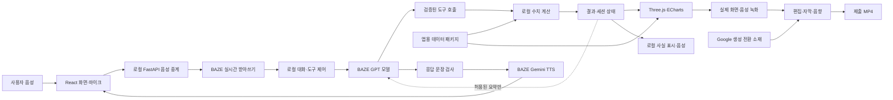

# NERVIS 시스템 구조

최신 구현 보충(2026-10-23): `backend/ai.py`의 도구 호출과 `GET /api/ai/status`, `POST /api/ai/chat`을 공통 텍스트 입력창에 연결했다. App의 요청 중→화면 적용 중→완료/실패 제어와 현재 영역 ID/샘플 구간 맥락 전달을 구현했다. 수치는 로컬 함수에서 계산·표시하고 모델에는 도구 상태만 보낸다. 상세 동작은 `docs/AI_TOOLS.md`, 프런트 설계23절을 따른다. 아래의 ‘대화/AI 미구현’은 이 텍스트 범위에 한해 과거 기록이다. 실계정 프런트 통합 시험·음성·브리핑·세션은 아직 미완료이며 외부 요청 예산은 기본0이다.

설계·갱신 기준: 2026-10-22. **3절의 앱 패키지, 4절의 로컬 함수, 10절의 데이터·분석 HTTP API와 10.3절의 공통 입력·로컬 분석 무대를 구현했다.** 실제 대화·음성·예술 모드·AI 도구 연결·세션과 관련 API는 앞으로 구현할 내용이다. 작품 범위와 우선순위는 [PROJECT_DIRECTION.md](PROJECT_DIRECTION.md)를 따른다.

## 1. 실행 구성

단일 PC에서 React 화면과 Python 서버를 실행한다. 데이터와 계산은 로컬에 두고, BAZE를 음성 인식·명령 해석·허용된 설명·음성 합성에 사용한다. 생성 영상은 촬영 전에 제작해 편집 소재로 넣는다.



상세 분석 결과의 전송 허용 범위가 미확정이면 LLM에는 명령·선택 ID·작업 상태만 주고 수치·결과 그래프는 로컬에서 표시한다. 상세 결과를 포함한 발화도 로컬 음성으로 처리한다. 외부 TTS에 문장을 보내는 것 역시 그 문장에 들어 있는 수치의 외부 전송이다.

## 2. 구성 요소의 책임

| 요소 | 책임 | 경계 |
|---|---|---|
| 데이터 패키저 | 제공 CSV·PNG와 기존 분석 결과를 앱 규격으로 연결 | 원본 밖에 출력, 입력 해시 검사 |
| 분석 모듈 | 대상·구간별 유사도·구조 지표·창별 비교 계산 | 계산을 LLM에 맡기지 않음 |
| 대화·도구 제어 | 모델 요청, 인자 검사, 실제 실행, 결과 보관, 상태 변경 | 임의 Python·셸·파일 경로 실행 금지 |
| 프런트엔드 | 뇌 단면·마스크·그래프·재생·음성 상태 표시 | 허용된 결과와 선택만 렌더 |
| 음성 중계 | 마이크 PCM 수신, STT 이벤트 정리, TTS 재생 연결 | 키 서버 보관, 녹음 상태 표시 |
| 제작 파이프라인 | 원본 촬영 보관, 컷·자막·음향·소재 합성, MP4 출력 | 실제 실행 기록과 생성 연출 구분 |

대화 연결 단계에는 DB 없이 단일 세션을 메모리에서 관리하고 재현·촬영 기록은 로컬 JSONL에 남길 계획이다. 현재는 상태 없는 데이터·분석 API만 구현했다. RAG나 별도 에이전트 프레임워크 없이 SDK의 도구 호출과 명시적인 실행 루프로 시작한다.

## 3. 앱용 데이터 패키지

원본: `C:\NERVIS\뇌영상 시계열 예시 데이터`. 출력: `C:\NERVIS\data\processed\nervis_v1\`. 기존 탐색 분석 결과: `C:\NERVIS\reports\data_analysis\`.

| 산출물 | 내용 | 검사 |
|---|---|---|
| `manifest.json` | 스키마 버전, 생성 코드 버전, 입력 SHA256, 배열의 축·크기, 단위·불명 정보 | 기존 원본 기준과 대조, 다른 데이터 버전 혼용 차단 |
| `regions.json` | 20개 ID, 좌우, 한국어·제공 이름, RGB, 두께·부피 | ID 1~20 중복·누락 없음, 단위 보존 |
| `signals.npz` | 원척도 BOLD, 표시용 z-score, sample 1~200 | 두 신호 `(200,20)`, 유한성, 원본 값 보존 |
| `signals_display.json` | 화면에 필요한 같은 신호·범위·표시 설명 | 내부 배열 0기준과 화면 1기준 대응 |
| `masks/` | 방향·단면별 단일 채널 ROI ID PNG, 0은 미라벨 | 정확한 RGB로 ID 변환, 알 수 없는 색은 실패 |
| `slices/` | 화면에 필요한 구조 단면의 로컬 복사·파생 이미지 | T1·마스크의 방향·단면·크기 일치 |
| `slice_index.json` | 영역별 노출·경계·적합한 단면 정보 | 기존 공간 분석과 대조, 빈 마스크 허용 |

위 파일은 `scripts/prepare_app_data.py`로 생성·검증했다. `regions.json`은 20개 객체의 목록이고, 단면 폴더는 방향별 하위 폴더로 나뉜다. 총 71개 파일이며 검증 기록은 `reports/data_preparation/validation.json`이다. `manifest.json`의 배열 축은 sample×region이다. 원본에 없는 TR·물리 좌표·개인 식별·촬영 상태를 채우지 않고 불명 값은 `null`과 설명으로 남긴다. [가공 방법](DATA_PREPARATION.md)

마스크 33장의 각 픽셀을 0~20의 ID로 보관하면 동일 영역을 선택·강조·크롭할 수 있다. PNG의 ID 값은 색 자체가 아니라 조회 키다. 화면 색은 `regions.json`에서 가져온다. 앱이 원본 폴더 전체를 정적 파일 서버로 공개하지 않도록 한다.

사전 계산은 고정 구간의 캐시로만 사용한다. 사용자가 구간·방법을 바꾸면 조건에 맞게 재계산하거나 완전히 같은 조건의 캐시를 조회한다. 캐시 키에 데이터 버전·영역·구간·방법·창 길이를 포함한다.

## 4. 실제 계산 규칙

- 시간점은 사용자·API에서 1~200, 양끝 포함으로 정의한다. NumPy 슬라이스로 바꿀 때만 시작점에서 1을 뺀다.
- 기본 유사도는 Pearson이다. Spearman은 요청한 경우 사용한다. 서로 다른 영역만 비교하고 같은 쌍을 두 번 세지 않는다.
- 전체 20영역은 190쌍, 좌우 대응은 ID `i`와 `i+10`의 10쌍이다. 두 검색 범위를 섞지 않는다.
- “가장 비슷한”은 기본적으로 양의 상관이 큰 순서다. “가장 덜 비슷한 좌우 쌍”은 해당 10쌍의 r 오름차순이다. 절댓값 순위와 다르며 화면에 기준을 표시한다.
- 구간이 너무 짧거나 해당 구간에서 분산이 0이면 계산 불가를 반환한다. 최소 3점은 수학적 입력 조건일 뿐 신뢰성 보장이 아니다. 짧은 구간 결과에는 구간 길이를 함께 표시한다.
- 창별 비교의 기본은 50점 창·10점 이동이며, 기존에 분석한 40·80점도 허용한다. 매 창의 새 평균으로 계산하고 현재 구간이 창보다 짧으면 오류를 설명한다.
- z-score는 전체 200점 기준 평균·표준편차(ddof=0)로 만든 표시용 값이다. 화면의 구간을 바꿀 때 몰래 재표준화하지 않는다.
- 두께·부피는 정적 값이다. 평균·합계를 표시할 경우 선택 ROI 집합의 기술 지표임을 명시한다.

기존 `scripts/analyze_data.py`의 알고리즘을 재사용한다. 앱 구현 때 필요한 순수 계산만 추출하고 기존 분석 스크립트가 같은 결과를 내는지 확인한다. 분석 보고서의 예시 ROI를 검색 함수의 반환값으로 고정하지 않는다.

로컬 구현은 `backend/data.py`의 `load_dataset`과 `backend/analysis.py`의 7개 함수다. `get_dataset_summary`, `get_region_info`, `get_timeseries`, `compare_regions`, `find_similar_pairs`, `analyze_pair_over_windows`, `get_region_slices`는 Dataset을 받아 JSON 호환 객체를 반환한다. `compare_regions`는 두 파형·상관과 정적 두께·부피의 B-A 차이를 함께 반환한다. 잘못된 인자는 ValueError, 상수 구간은 `unavailable`·`correlation: null`로 구분한다.

로더는 패키지 해시·버전·축·ID·정규화·단면 참조를 검사하고 신호 배열을 읽기 전용으로 보관한다. 원본 대조·이미지 의미 검사는 별도 오프라인 검증에서 수행하며 요청마다 원본을 다시 읽지 않는다. `scripts/verify_local_analysis.py`에서 기존 Pearson·Spearman 각각 190쌍과 이동 창 8,740개를 절대 오차 `1e-12` 이내로 대조했다. 기록은 `reports/local_analysis/validation.json`이며 함수와 합성 테스트에는 실제 데이터·키가 없다.

## 5. 도구 규격

2026-10-22 구현 상태: 아래 계획 중 데이터 조회·비교·검색·이동 창·단면 도구7개를 `backend/ai.py`에서 기존 함수와 연결했고 `POST /api/ai/chat`을 추가했다. 호출 예산은 기본0, 명령당 Responses 최대2회·출력 회당512토큰, 한 번의 도구 묶음 최대6개다. 상세 결과는 로컬에만 반환하며 모델에는 상태만 전달한다. 합성 검사를 통과했지만 실계정 생성·프런트·대화 이력·음성 연결은 아직 없다. 최신 상세는 [AI_TOOLS.md](AI_TOOLS.md)다. 이 아래 ‘예정/미구현’ 표기는 최초 기획 기록이며 위 구현 범위에 한해 갱신한다.

아래 이름은 앱 내부 도구의 예정 이름이다. 대응하는 로컬 계산 함수 일부는 구현했지만, 모델용 도구 스키마·실행 제어·세션 연결은 아직 없다. 어떤 도구를 어떤 순서로 호출할지는 대화·현재 상태에 따라 모델이 정한다.

| 도구 | 주요 인자 | 실제 실행과 결과 |
|---|---|---|
| `get_dataset_summary` | 없음 | 데이터 종류·20 ROI·200점·미상 단위 등을 조회 |
| `find_similar_pairs` | 구간, 방법, `all`/`homologous`, 정렬, 상위 개수 | 해당 조건의 순위를 계산하고 결과 ID 저장 |
| `select_regions` | ROI ID 목록 | 영역 존재 검사 후 선택 갱신, 관련 단면 결정 |
| `compare_regions` | ROI ID, 구간, 지표 | 파형·유사도 또는 정적 두께·부피를 계산·조회 |
| `analyze_pair_over_windows` | 두 ROI, 구간, 창 길이, 이동 폭 | 창별 r·구간 경계·최소/최대 반환 |
| `set_sample_range` | 시작·끝 시간점 | 유효 범위 검사, 후속 분석·재생 범위 갱신 |
| `set_view` | 방향·단면·`overview`/`compare` | 실제 있는 단면·ROI 노출을 확인하고 레이아웃 변경 |
| `control_playback` | 재생·정지·이동, 속도 | 데이터 시간점 커서를 제어. 분석 구간과 분리 |
| `set_art_mode` | 켜기/끄기, 허용된 매핑 이름 | 현재 데이터·선택을 미리 정의한 표현 규칙에 연결 |

“아까로”는 세션의 직전 선택·구간·화면으로 돌아가는 상태 복원으로 처리한다. 모델이 세션에 없는 결과를 기억했다고 가정하지 않는다. 불명확한 “둘”이나 “이 구간”은 현재 선택·최근 결과로 해소하고, 후보가 여러 개면 짧게 되묻는다.

## 6. 세션과 실행 순서

세션에는 `session_id`, `dataset_version`, `selected_region_ids`, `sample_range`, `current_sample`, `view`, `layout`, `playback`, `art_mapping`, `last_result_id`, 직전 상태, 대화 이력을 둔다. 화면의 선택 상태를 기준으로 맥락을 판단한다.

1. 최종 확정된 발화나 텍스트를 명령으로 받는다. STT 중간 토큰으로 분석을 실행하지 않는다.
2. 모델에 허용 도구·명령·현재 상태와 전송 가능한 정보만 전달한다.
3. 모델이 반환한 도구 이름·인자를 Pydantic으로 검증한다. 범위 밖 ID·경로·알 수 없는 기능은 거절한다.
4. 도구를 실행해 결과와 새 상태를 만들고 `result_id`·상태 버전을 부여한다.
5. 실제 실행 성공 이벤트와 결과로 화면을 갱신한다. 화면 적용 확인 전 “보여드렸습니다”라고 확정하지 않는다.
6. 허용된 결과 요약을 모델에 돌려주거나, 제한 모드에서는 로컬 결과 핸들과 작업 성공 상태만 반환한다.
7. 응답의 수치·이름·단위를 결과와 대조한다. 근거 없는 수치는 표시·합성하지 않는다.
8. 짧은 답변을 합성·재생하고 다음 명령을 기다린다.

도구 실행 횟수는 한 발화당 최대 6회로 시작하고, 같은 요청의 중복 이벤트가 상태를 반복 변경하지 않게 한다. 네트워크 오류·도구 실패는 실패 이벤트로 끝낸다. 영상 생성 같은 유료 작업을 대화 도구 목록에 넣지 않아 반복 호출을 막는다.

## 7. 하드코딩의 경계

| 코드에 정의할 것 | 입력·계산·모델에 따라 달라질 것 |
|---|---|
| 도구 스키마, 수학 공식, 상태 전환, 색·밝기 매핑 | 사용자 문장의 표현과 후속 질문 |
| 데이터의 실제 ID·이름·팔레트 | 선택 ROI, 분석 구간, 검색 범위·순위 |
| 오류 처리, 수치 포맷, 입력 검증 | 도구 선택·실행 순서와 결과에 맞는 설명 |
| 촬영 구도·허용된 화면 배치 | 실제 결과 수치·파형·마스크 강조 |

확인용 촬영 문장을 준비하는 것은 가능하다. 문장 전체 일치로 장면 번호를 재생하거나, “가장 비슷한 쌍” 질문에 고정 ID·답변을 반환하는 방식은 사용하지 않는다. 고정된 자료에서 같은 조건의 결과가 반복되는 것은 정상이다.

## 8. 화면과 예술적 매핑

| 화면 | 데이터와 연결 | 표현 |
|---|---|---|
| 개요 | 실제 T1 단면과 20 ROI 마스크 | 중앙 단면·선택 영역·간결한 상태 표시 |
| 영역 비교 | 같은 ID의 마스크·파형·구조 지표 | 주변을 낮추고 선택 영역 확대, 좌우 비교 패널 |
| 시간 탐색 | sample 커서와 BOLD/z-score | 그래프·ROI 밝기를 같은 커서로 갱신 |
| 관계 탐색 | 같은 조건에서 계산한 r | 선택 쌍의 선·강도·설명. 실제 신경 섬유처럼 표시하지 않음 |
| 예술 장면 | 고정된 형태 + 상대 변화·관계 | 빛·입자·리듬. 화면/크레딧에서 창작 매핑임을 설명 |

초기 밝기는 `clip(z,-3,3)`을 0~1로 옮긴 값을 사용하고, 범위를 벗어나 잘린 점은 설명에 남긴다. 이 규칙은 원자료를 바꾸지 않는다. 두께·부피를 크기나 선 굵기에 매핑한다면 실제 MRI 형태와 별도의 추상 도형에 적용하고 단위를 함께 제공한다.

단면을 입체로 배치할 때 한 방향씩 상대적 깊이를 부여한다. Axial과 Coronal을 근거 없이 동일 물리 좌표에 합치지 않는다. MRI 화면 좌우 방향은 표시 관례를 추정해 뒤집지 않고 제공 라벨의 반구명을 사용한다. ROI 내부 전체 픽셀에 같은 평균 시계열을 적용하는 효과는 영역 평균의 표현이지 내부 신호 전파가 아니다.

초기 성능 목표는 1080p 화면에서 30fps 이상이다. 실제 PC에서 측정하고, 부족하면 입자 수·글로우·동시 단면 수를 줄인다. 신호 200점은 미리 로딩하고 카메라·밝기는 프레임 루프에서 갱신한다. 33장 전체의 고해상도 텍스처를 매 프레임 다시 만들지 않는다.

## 9. 음성 흐름

- 브라우저에서 사용자가 마이크를 허용하고 세션을 켠다. 듣는 동안 이를 표시하며 명시적으로 종료할 수 있다.
- `getUserMedia`·Web Audio로 받은 음성을 정해진 PCM으로 변환한다. 서버는 BAZE Soniox WebSocket을 중계하고 최종 텍스트를 명령으로 확정한다.
- 초기에는 같은 STT 세션에서 “NERVIS/너비스” 호출어를 인식해 활성화한다. 전용 로컬 호출어 모델을 만들지 않는다. 마이크 세션의 음성은 외부 STT로 전송되므로 상시 실행 대신 촬영·사용할 때만 켠다.
- 시스템이 말할 때는 입력 명령 처리를 멈춰 스피커 음성을 다시 명령으로 실행하지 않게 한다. 초기 버전은 동시 끼어들기보다 순차 대화를 안정화한다.
- TTS는 짧은 실제 응답을 합성한다. 반환된 PCM에 WAV 헤더를 붙이거나 Web Audio로 재생하고 타임스탬프를 기록한다.
- 한국어 모델·목소리·숫자 읽기·호출어 인식은 실제 환경에서 시험한다. 호출어가 불안정하면 마이크 활성 버튼을 유지하고 실제 동작 범위를 영상에 맞게 설명한다.
- 실시간 STT 권한이 없으면 BAZE 파일 STT로 짧은 발화를 시험한다. 지연이 시나리오에 맞지 않으면 로컬 STT 도입을 별도 결정하고, 사전 녹음 대사를 실시간 인식 결과로 대체하지 않는다.

문장 종료부터 첫 화면 동작까지 5초 이내를 초기 목표로 측정한다. 이는 보장 수치가 아니다. STT 확정·모델 응답·계산·TTS 시간을 나눠 기록해 느린 부분을 조정한다. [BAZE 실시간 음성 문서](https://docs.mindlogic.ai/docs/hallym-ac/api-gateway/reference/realtime)

## 10. 로컬 API와 이벤트

현재 구현은 `backend/app.py`와 `backend/schemas.py`다. `python -m backend`로 127.0.0.1:8000에 실행한다. 패키지는 lifespan 진입 때 한 번 로딩하고, 각 라우트는 기존 Python 함수를 호출한다. 실제 계정·환경 파일·네트워크 서비스는 사용하지 않는다.

| 구현한 인터페이스 | 역할 |
|---|---|
| `GET /api/health` | 패키지 준비 상태·데이터 버전 |
| `GET /api/dataset` | 자료 요약·단위·미상 정보 |
| `GET /api/regions` / `GET /api/regions/{region_id}` | 영역 목록·상세 |
| `GET /api/regions/{region_id}/slices` | 방향별 단면 목록·추천 단면 |
| `POST /api/analysis/timeseries` | 영역·구간별 원척도·표시용 파형 |
| `POST /api/analysis/compare` | 두 영역의 상관·파형·정적 구조 비교 |
| `POST /api/analysis/pairs` | 조건별 전체/좌우 쌍 검색 |
| `POST /api/analysis/windows` | 창별 상관과 유효 창의 최소·최대 |
| `GET /api/slices/{orientation}/{slice_index}/{kind}` | 인덱스에 등록된 T1 또는 ID 마스크 PNG |

POST 본문은 strict Pydantic 모델로 검사하며 추가 필드를 거절한다. 잘못된 입력은422, 유효한 상수 구간은200 + unavailable/null, 없는 단면은404다. 이미지 경로·파일 해시를 다시 검사해 서버 시작 뒤 변경·경로 이탈은409로 거절한다. 원본·manifest·임의 경로의 파일을 제공하는 API나 StaticFiles 마운트는 없다. 현재의 상세 데이터 응답은 로컬 브라우저용이며 외부 LLM 전송 허가를 의미하지 않는다.

`/docs`는 요청을 시험하는 Swagger 화면이고 `/openapi.json`은 API 명세다. Swagger의 기본 리소스는 CDN을 사용하지만 서버는 외부 서비스를 호출하지 않는다. 로컬 5173 포트만 CORS로 허용하고 localhost/127.0.0.1 Host만 받는다. 합성 HTTP 검사는 `tests/test_api.py`, 실제 HTTP 검증 기록은 `reports/backend/http_validation.json`이다.

아래 대화·결과 저장·이벤트·음성 인터페이스는 **미구현**이다. 현재 서버가 자연어를 이해하거나 대화 상태를 보관하는 것으로 취급하지 않는다.

| 인터페이스 | 역할 |
|---|---|
| `POST /api/session` | 단일 세션 생성·초기화 |
| `POST /api/command` | 텍스트 명령 제출, 음성 확정문도 같은 경로로 처리 |
| `GET /api/results/{result_id}` | 로컬 계산 결과 조회 |
| `WS /api/events` | 도구 상태·선택·화면 변경·오류 이벤트 |
| `WS /api/voice` | 마이크 오디오와 STT·TTS 상태 중계 |

이벤트는 최소한 `session_id`, `request_id`, `type`, `state_version`, `payload`를 가진다. `command.accepted`, `tool.started`, `tool.completed`, `state.changed`, `speech.started`, `error`를 구분한다. 연결이 끊긴 뒤 재접속하면 마지막 상태를 다시 받아 화면을 맞춘다.

### 10.1 첫 프런트 구현

`frontend/`의 React·TypeScript·Vite 앱이다. `App.tsx`가 타이틀 이동·홈/분석 전환과 초기 API 조회를 관리하고, `CoreScene.tsx`가 Three.js·React Three Fiber로 자체 생성한 구형 구조를 그린다. 프레임마다 React 상태를 갱신하지 않으며, 등장 시 CSS 확대와 실제 캔버스 크기를 구분해 측정한다. 움직임 축소 설정·WebGL 실패 경로를 제공한다.

`AnalysisView.tsx`는 regions/dataset/compare/slices와 등록 PNG를 사용한다. 같은 이름의 반대쪽 ROI를 비교하며 전체 구간 파형은 공통 세로축 SVG로, ID 마스크는 Canvas 2D에서 실제 팔레트로 변환한다. 요청 취소·버전 검사·현재 선택 키로 늦은 응답을 차단한다. 홈 전환 시 컴포넌트를 보존해 선택을 유지한다. 아직 임의 쌍·창별 관계·구간 재생·ECharts는 없다.

`audio.ts`는 Web Audio 합성음과 AnalyserNode 기반의 로컬 반응 미리보기다. 실제 AI·TTS·마이크 연결로 표시하지 않는다. 재생·중지·자동 종료·화면 전환에서 오디오 자원을 정리한다. 이후 실제 응답 오디오를 연결할 자리이며 별도 외부 호출은 없다.

Vite는127.0.0.1:5173에 바인딩하고 `/api`만127.0.0.1:8000으로 프록시한다. `envDir: false`로 루트 `.env`를 읽지 않고 파일 제공 범위를frontend로 제한했다. 키·원본·패키지를 정적 자산에 복사하지 않았다. Node22.20 환경에서 합성 검사6개·타입/빌드를 확인했고, 실제 UI는1280×720 및 좁은 앱 패널에서 확인했다. 보존·접근 차단·스크린샷은Git 제외인 `reports/frontend/`에 둔다. OS 움직임 축소·모바일/다른 브라우저·1080p30fps와 독립 코드 검토는 미검증이다. Three.js를 포함한 큰 번들 경고와 R3F 내부 THREE.Clock 사용 중단 예정 경고가 남아 있다.

### 10.2 코어·공통 화면 추가 구현

`model.ts`가 곡면 패널·발광 텍스처·회전/음량 규칙을 만들고 `CoreScene.tsx`가 기존 Three.js/R3F로 렌더한다. `Interface.tsx`·`interface.css`는 공통 입력창·T/마이크 접힘과 초점 이동을 담당한다. 초기 미연결 정보 카드는 피드백에 따라 제거했고 실제 브리핑 후 카드 표시는 미구현이다. 초안은 App 메모리에만 보존한다. 미연결 전송은 비활성이고 음성 버튼은 안내만 열어 브라우저 마이크를 사용하지 않는다. 초기 화면의 불필요한 이전 셸 CSS는 제거했다.

API·백엔드·환경 파일은 변경하지 않았다. 현재 실제 분석은 명시된 수동 미리보기로 연결하며 음량 입력은 로컬 합성음이다. 분석 무대 확장·날씨/시간표 도구·전체 요청 제어·실제 AI/음성은 남았다. 추가 검사9개·독립 정적 검토·키보드 초점 회귀 검증과1280×720 및 실제 앱 창 UI 확인 기록은 `reports/frontend-v2/`에 둔다. 1080p 성능·모바일·OS 움직임 축소의 실제 검증은 하지 않았다.

### 10.3 공통 입력·로컬 분석 무대

2026-10-22 구현. `Interface.tsx`는 텍스트/음성 모드에 같은 textarea를 사용하고 초안을 App 메모리로 유지한다. 음성 모드는 STT 미연결·마이크 꺼짐 표시이며 실제 녹음·음성 전송은 없다. 10.1~10.2절은 이전 구현 이력이다.

`stageData.ts`는 기존 pairs→compare/windows/slices→로컬 이미지 API를 연결한다. 대응 쌍 상관 내림차순 검색 후 두 ROI의 공동 가시성을 기준으로 방향·단면을 선택한다. AbortController와 버전 일치 검사를 적용하며 계산·이미지 준비 완료 전 조작을 잠근다. `analysisModel.ts`는 픽셀 좌표·ID 마스크를 점군·영역 경계/중심으로 바꾸고 샘플 범위 내 재생을 계산한다. `BrainStage.tsx`는 최대5개의 실제 단면을 표시용 깊이로 배치하고 실제 MRI와 ROI 확대를 병치한다. 물리적 깊이·정밀 3D·직접 신경 경로는 제공하지 않는다.

`AnalysisView.tsx`는 실제 두 신호·전체/50샘플 창의 Pearson r·선택 범위·커서/재생과 상세 dialog를 동기화한다. 표시 재생은10 samples/s이고 실제 획득 시간이 아니다. 새 서버 경로·DB·외부 서비스·라이브러리는 추가하지 않았다. 자연어 실행·대화 세션·실제 음성은 후속 연결이다. 상세 검증/한계는 [프런트 설계12절](FRONTEND_DESIGN.md#12-공통-입력창분석-무대-확장-2026-10-22)을 따른다.

## 11. 프로젝트 폴더와 예정 위치

아래는 현재 파일과 앞으로 만들 위치를 구분한 구조다. 앱용 데이터와 테스트 외에 빈 제품 폴더는 미리 만들지 않는다.

```text
C:\NERVIS\
  AGENTS.md                         기존, 원본·공개 규칙
  README.md                         기존, 진입 안내
  docs/                             현재 데이터·기획·연결 문서
    (구 기획은 tmp/repo_cleanup_20261029_205611/에 로컬 백업)
  scripts/
    analyze_data.py                 기존 탐색 분석
    prepare_app_data.py             구현, 오프라인 앱 패키지 생성·검증
    edit_video.py                   예정, 촬영본 편집·최종 출력
  backend/                          구현, 로더·로컬 분석·FastAPI; BAZE·세션은 예정
  frontend/                         구현, 첫 React·Three.js 화면; AI·음성 UI는 예정
  tests/                            구현, 합성 자료 가공·보호·변조 거절 검사
  assets/                           예정, 직접 제작·공개 가능한 로고/스타일
  data/processed/nervis_v1/          생성·검증 완료, 비공개 앱 데이터
  reports/data_preparation/          생성, 비공개 가공 검증 기록
  reports/data_analysis/            기존, 비공개 상세 분석
  reports/sessions/                 예정, 비공개 도구 실행 기록
  reports/production/               예정, 촬영·음성·소재·편집·제출 파일
    capture/  media/  edit/  final/
  tmp/                              기존, 임시·자료 조사·성능 시험
  뇌영상 시계열 예시 데이터/         원본, 절대 변경 금지
```

`backend/`는 처음부터 여러 서비스로 쪼개지 않는다. 앱 진입점·데이터/분석·BAZE 통신·세션/도구에 필요한 소수 모듈부터 만든다. 코드·가짜 데이터 테스트는 Git 관리하고, 실제 마스크·파형·촬영본·로그·키는 로컬에 둔다.

## 12. 외부 전송·키·오류 처리

- 서버는 기본 `127.0.0.1`에서 실행하고 CORS는 로컬 프런트엔드만 허용한다. 파일 경로 대신 검사된 데이터 ID로 조회한다.
- `BAZE_API_KEY`는 서버 환경 또는 Git 제외된 로컬 비밀 파일에 둔다. `VITE_` 변수·브라우저 번들·일반 로그에 넣지 않는다.
- 외부 입력은 사용자 명령·최소 상태·허용된 결과 요약으로 제한한다. 원본 PNG·CSV·PDF·상세 마스크·전체 시계열을 모델·영상 API로 보내지 않는다.
- 전송 범위 미확인 모드에서는 결과 수치·파형·구조 값은 로컬 표시, 상세 발화는 설치된 로컬 음성만 사용한다. 로컬 한국어 음성도 사용 가능 여부를 확인한다. 모델에는 수치 대신 결과 핸들을 주고 임의 수치를 말하지 않도록 한다.
- 요약 전송이 허용되면 범위를 문서에 기록한 뒤 해당 수치만 LLM·TTS에 전달한다. 재구성 가능한 자료가 작은 요약으로 둔갑하지 않게 한다.
- 401·403은 자동 반복하지 않고 설정·권한 오류를 알린다. 429·일시적 5xx는 제한된 재시도 후 중단한다. 이전 결과가 있으면 그대로 두되 새 계산이 성공한 것처럼 표시하지 않는다.
- 영상 생성 작업은 별도 제작 명령에서 다루고 비용 견적·작업 ID·상태를 기록한다. 시간 초과 후 새 유료 작업을 즉시 중복 제출하지 않는다.

## 13. 구현 검증 기준

1. **데이터:** 원본 해시, 20 ID·RGB·두께·부피·열 순서, 빈 마스크, 모든 단면 대응을 검사한다.
2. **계산:** 알려진 합성 신호의 상관·상수 구간·범위·창 개수를 검사하고 실제 자료 결과를 기존 분석과 대조한다.
3. **도구:** 잘못된 ID·구간·인자를 거절하고 실행 실패·중복 요청에서 화면이 잘못 갱신되지 않는지 확인한다.
4. **맥락:** 같은 뜻의 서로 다른 문장과 순서 변경, “둘/아까/전체”, 구간 변경 후 재계산을 확인한다.
5. **음성·화면:** 실제 마이크로 호출·최종문 확정·숫자 발음·에코·선택과 재생 동기화를 확인한다.
6. **실행 증거:** 발화→도구→인자→결과 ID→화면 상태를 한 기록으로 연결한다. 키·원본은 기록에 넣지 않는다.
7. **최종:** 실제 연속 실행 촬영, 음성·자막·영상의 동기화, 전체 MP4 디코딩·서로 다른 재생기 확인, 작업 후 원본 해시 확인.

입력 해시·앱용 패키지·합성 자료의 변환·오류 차단, 로컬 함수의 수치·구간·순위·반환값 격리와 HTTP 데이터·분석 경로를 검증했다. 서버는 합성 테스트와 실제 로컬 HTTP·PNG 요청으로 확인했다. 첫 화면은로컬 UI·API·파일 접근 차단과 합성 로직을 확인했다. 도구·대화 맥락·실제 음성·촬영·고급 화면 검증은 해당 기능 구현과 함께 수행하며 현재 검사로 대체하지 않는다.
