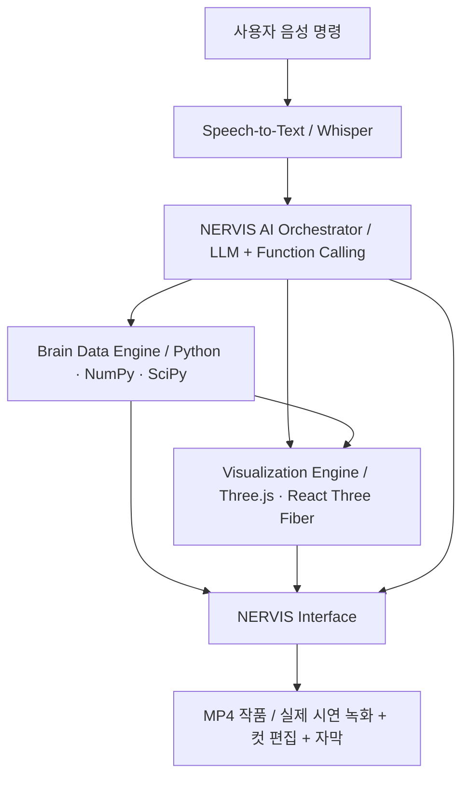

# NERVIS 프로젝트 개발 기획 및 기술 스택 정리

> **기획 v0.1** · 2026.10.13 기준 · 데이터 미확보 상태

지금은 바로 코딩을 시작하기보다, **NERVIS가 무엇을 보여줄 것인지, 어떤 기술로 구현할 것인지, 실제 뇌 데이터가 들어오면 어떻게 연결할 것인지**부터 설계하는 게 좋아.

특히 이번 대회는 AI 모델의 정확도를 경쟁하는 대회가 아니라, **뇌 데이터를 AI로 재해석한 디지털 예술 작품을 만드는 대회**라는 점을 계속 염두에 둬야 해.

NERVIS를 단순한 뇌 데이터 분석 프로그램이 아니라, **JARVIS 스타일의 음성 대화형 AI와 시각 예술을 결합한 시스템**으로 기획한다.

> **목표 디자인 콘셉트:** 화면 중앙의 뇌 시각화, 주변의 분석 정보, 음성 인터랙션을 결합한 미래지향적 HUD 인터페이스.

---

## 1. 프로젝트 기본 방향

| 항목 | 계획 |
|---|---|
| 팀명 | NERVIS |
| 프로젝트명 | Project N.E.R.V.I.S. |
| 이름 의미 | Neural Enhanced Recognition & Visualization Intelligence System |
| 참가 분야 | 그 외 자유주제 |
| 핵심 기능 | 음성 기반 뇌 데이터 분석, AI 설명, 2D/3D 시각화 |
| 사용자 인터페이스 | JARVIS 스타일의 미래지향적 HUD |
| 최종 제출 | MP4 시연 영상 + AI 활용 보고서 PDF |
| 제외 기능 | 음악 생성·뇌 신호를 음악으로 변환하는 기능 |
| 개발 목표 | 실제 동작하는 시스템을 구현한 후 화면과 상호작용을 영상화 |

### 우리가 만들려는 작품

> 사람의 눈으로 쉽게 이해하기 어려운 뇌 데이터를 AI가 해석하고, 그 특징을 빛과 형태, 움직임으로 변환해 누구나 직관적으로 경험할 수 있도록 하는 지능형 시각화 시스템.

핵심은 세 가지다.

1. **Intelligence:** 음성 명령을 이해하고 실제 뇌 데이터의 특징을 분석·설명하는 AI
2. **Visualization:** 분석 결과가 실제로 시각적 요소를 변화시키는 2D/3D 시각화
3. **Interaction:** 사용자가 음성으로 데이터 탐색 및 시각 효과를 제어하는 JARVIS 스타일의 경험

---

## 2. 전체 시스템 아키텍처



- **사용자 음성 명령:** “NERVIS, 뇌 데이터를 분석해 줘.”
- **Speech-to-Text:** Whisper로 음성을 텍스트로 변환.
- **NERVIS AI Orchestrator:** 명령 분류, 도구 선택, 결과 설명.
- **Brain Data Engine:** MRI/시계열 로딩, 전처리, 특징 추출.
- **Visualization Engine:** 3D 뇌, 단면, 파티클, 애니메이션.
- **NERVIS Interface:** 분석 결과, 실시간 그래픽, AI 음성 응답.
- **MP4 작품 제작:** 실제 시연 녹화, 컷 편집, 자막.

**LLM이 수치 분석을 직접 수행하는 게 아니라, Python 분석 도구가 실제 계산한 결과를 받아 해석하고 시각화 기능을 호출하도록 분리한다.**

---

## 3. 필요한 기술 스택 전체 정리

우선순위 구분:

- **P0:** 반드시 구현해야 하는 핵심
- **P1:** 작품 완성도와 자비스 느낌을 높이는 기능
- **P2:** 시간이 남는 경우 추가하는 고급 기능

### A. 프론트엔드 및 시각화

| 기술 | 역할 | 우선순위 |
|---|---|---|
| React + TypeScript | UI 및 상태 관리 | P0 |
| Vite | 빠른 개발 환경 | P0 |
| Tailwind CSS | HUD 디자인 | P0 |
| Three.js | 3D 그래픽 렌더링 | P0 |
| React Three Fiber | React에서 Three.js 관리 | P0 |
| Drei | 카메라·텍스트·3D 도우미 | P1 |
| Recharts | 시계열 그래프 표시 | P1 |
| Framer Motion / Motion | UI 전환 및 애니메이션 | P1 |
| GLSL Shaders | 발광, 왜곡, 데이터 기반 효과 | P2 |
| GSAP | 복잡한 연출 타임라인 | P2 |

Three.js는 웹에서 3차원 그래픽을 구현하는 라이브러리이므로, 브라우저에서 자비스 스타일의 홀로그램 효과를 구현하는 데 적합하다.

### B. 백엔드 및 AI

| 기술 | 역할 | 우선순위 |
|---|---|---|
| Python | 데이터 분석·AI 구현 | P0 |
| FastAPI | 분석 및 명령 실행 API | P0 |
| NumPy | 배열 및 행렬 연산 | P0 |
| SciPy | 신호 처리·통계 계산 | P0 |
| Pydantic | 분석 요청·응답 구조 검증 | P0 |
| WebSocket | 분석 진행 상태 및 시각화 이벤트 전달 | P1 |
| LLM API 또는 로컬 LLM | 자연어 명령 해석·결과 설명 | P1 |
| Tool / Function Calling | 명령과 분석 함수 연결 | P1 |
| PyTorch | 학습 기반 분석 모델이 필요할 때 | P2 |

FastAPI는 WebSocket을 통한 양방향 데이터 교환을 지원해, AI 상태나 분석 이벤트를 프론트엔드에 전달할 수 있다.

**PyTorch는 처음부터 필수가 아니다.** 데이터 전처리와 통계 기반 특징 추출도 AI 시스템의 분석 파이프라인으로 활용할 수 있지만, 대회에서 AI의 실제 기여를 명확히 보여주려면 LLM이나 학습 모델이 수행한 작업도 구체적으로 기록해야 한다.

### C. 뇌 데이터 처리

데이터가 아직 공개되지 않았으므로 MRI와 시계열 데이터를 모두 지원할 수 있도록 준비한다.

| 데이터 유형 | 예상 기술 | 구현 기능 |
|---|---|---|
| MRI (`.nii`, `.nii.gz`) | NiBabel | 3D 볼륨 로딩, 단면 추출 |
| MRI (`.dcm`) | pydicom | DICOM 메타데이터·영상 접근 |
| MRI 이미지 (`.png`, `.jpg`) | OpenCV, Pillow | 영상 처리·특징 추출 |
| EEG (`.edf`, `.fif`) | MNE-Python | 채널별 시계열·주파수 분석 |
| 시계열 (`.csv`, `.xlsx`) | pandas, NumPy | 파형 분석 및 시간축 처리 |
| 공통 | SciPy, scikit-image | 정규화, 필터링, 경계·영역 처리 |

MNE-Python은 EEG/MEG 신호 및 주파수 스펙트럼 분석과 시각화 기능을 제공한다.

**모든 시계열이 EEG인 것은 아니다.** 제공 데이터가 fMRI BOLD 신호나 다른 형태의 시계열이라면 분석 방법을 변경해야 한다.

### D. 자비스 음성 인터랙션

| 기술 | 역할 | 우선순위 |
|---|---|---|
| 브라우저 마이크 API | 사용자 음성 입력 | P0 |
| faster-whisper | 한국어 음성 인식 | P1 |
| 명령 라우터 | 음성 명령을 시스템 기능에 연결 | P0 |
| LLM | 자유로운 자연어 명령 해석 | P1 |
| TTS | 자비스 스타일 음성 응답 | P1 |
| Wake Word Detection | “NERVIS” 호출어 감지 | P2 |
| VAD | 음성 구간 자동 감지 | P2 |

faster-whisper는 Whisper의 음성 인식 구현체로, CPU/GPU 기반 추론을 지원한다.

음악 생성은 하지 않지만, **자비스가 말로 답하는 TTS는 유지하는 걸 추천한다.** 시스템의 정체성을 드러내는 데 도움이 된다.

### E. 영상 제작 및 제출

| 기술 | 역할 |
|---|---|
| OBS Studio | 실제 시스템 시연 화면 녹화 |
| DaVinci Resolve / CapCut | MP4 영상 편집 |
| FFmpeg | 인코딩·영상 병합·화질 조정 |
| Figma | HUD 화면 디자인 시안 |
| Blender | 선택적 3D 뇌 모델·인트로 렌더링 |

모든 후보 기술을 설치하거나 적용할 필요는 없다.

**1차 권장 핵심 스택: `React + TypeScript + Vite + Three.js/R3F + FastAPI + NumPy/SciPy + Whisper + LLM`.** 데이터가 확인되면 NiBabel이나 MNE를 선택적으로 추가한다.

---

## 4. 데이터가 도착하기 전 설계해야 할 핵심 기능

NERVIS는 데이터가 들어온 뒤에 처음부터 구조를 바꾸지 않도록 **데이터 처리부와 화면 렌더링 부분을 분리**하는 게 중요하다.

### 기능 1. 음성 기반 AI 명령

사용자가 자연어로 분석을 요청하면, 명령 라우터가 해당 기능을 실행한다.

| 사용자 명령 예시 | 시스템 기능 |
|---|---|
| “NERVIS, 시스템 시작해.” | 부팅 애니메이션 및 음성 응답 |
| “첫 번째 뇌 데이터를 불러와.” | 데이터셋 선택 및 로딩 |
| “뇌 구조를 보여줘.” | MRI 2D/3D 시각화 |
| “이 영역을 확대해 줘.” | 카메라 및 영역 확대 |
| “가장 특징적인 부분을 강조해 줘.” | 사전 정의한 기준에 따른 특징 강조 |
| “분석 결과를 설명해 줘.” | 통계·분석 결과를 LLM이 자연어로 설명 |
| “시각화 모드를 변경해 줘.” | 색상·파티클·애니메이션 변경 |

구현 단계:

1. **1단계:** 정해진 명령을 안정적으로 실행하는 Command Router
2. **2단계:** LLM이 자연어를 해석해 필요한 도구를 호출하는 AI Orchestrator

영상 촬영을 위해서는 1단계부터 반드시 완성하고, 2단계는 이후 추가하는 편이 안전하다.

### 기능 2. MRI 기반 3D 뇌 시각화

**시각적 대비:** 원본 MRI 단면 → 실제 데이터 특징을 반영한 NERVIS의 3D 홀로그램 표현.

구현해야 할 핵심 기능:

- MRI 슬라이스 탐색 (Axial, Sagittal, Coronal)
- 영상 밝기·대비 조정 및 특징 추출
- 3D 볼륨 또는 표면 시각화
- 특정 영역의 강조·회전·확대
- 분석 결과에 따른 색상·빛·파티클 변화

**실제 MRI에서 3D 뇌 구조를 정확하게 복원하는 것은 어려운 작업이다.** 데이터가 단순 2D 이미지라면 3D 복원 결과라고 표현하면 안 되고, 일반 3D 뇌 모델을 활용한 예술적 표현이라고 구분해야 한다.

### 기능 3. 시계열 데이터 시각화

개발 중에는 **가상 신호**로 시계열 파형 UI를 테스트한다. 실제 데이터가 확보되면 분석 및 그래프를 교체한다.

| 실제 분석 특징 | 시각적 표현 규칙 |
|---|---|
| 신호 진폭 | 파티클 크기 및 발광 강도 |
| 주파수 대역별 파워 | 색상 계열 및 진동 속도 |
| 시간에 따른 변화량 | 파동의 확산 속도 |
| 채널 간 관계 | 시각적 연결선 또는 공간적 군집 |
| 급격한 변화 지점 | 순간적인 빛의 확산 효과 |

**데이터의 종류·단위·채널 위치를 먼저 확인해야 한다.** EEG 채널 위치가 없으면 임의의 뇌 영역에 신호가 발생했다고 표시하지 않도록 해야 한다.

### 기능 4. AI 설명 및 데이터 근거 제시

AI는 근거 없이 뇌 상태를 추정하기보다는, 실제 분석 근거를 보여주는 방향으로 설계한다.

> **NERVIS ANALYSIS:** “선택된 시계열 구간의 주요 변동 패턴을 분석했습니다. 현재 시각화는 신호 진폭과 주파수 특징을 기반으로 생성됩니다.”

분석 화면에는 다음 항목을 표시한다.

- **데이터 출처:** 실제 데이터셋 ID
- **분석 방식:** 사용된 알고리즘
- **시각화 방식:** 특징 → 그래픽 매핑 규칙

이 정보는 **AI 활용 보고서의 근거**로도 사용할 수 있다.

---

## 5. 실제 데이터 종류별 개발 분기

데이터가 없을 때는 기술 선택을 확정하면 안 된다. 크게 세 가지 경우를 가정한다.

### 시나리오 A. MRI 영상 중심

- **필요 기술:** NiBabel, NumPy, scikit-image, Three.js/R3F, FastAPI, LLM
- **핵심 작품:** 뇌의 구조적 특징을 추출해 3D 형태, 빛, 색상, 카메라 이동으로 재해석하는 작품.
- **주의점:** 원본 해상도와 분할 정보에 따라 실제 3D 재구성 가능성이 달라진다.

### 시나리오 B. 시계열 신호 중심

- **필요 기술:** pandas, NumPy, SciPy, MNE(EEG인 경우), Three.js/R3F, FastAPI, LLM
- **핵심 작품:** 시계열 패턴에 반응해 실시간으로 변화하는 추상적 신경 신호 시각화.
- **주의점:** 데이터 의미를 모르면 임의의 감정·의학적 상태를 추정하면 안 된다.

### 시나리오 C. MRI + 시계열 모두 제공 — 추천 시나리오

- **필요 기술:** NiBabel, NumPy, SciPy, pandas, MNE(해당 시), Three.js/R3F, FastAPI, LLM
- **핵심 작품:** MRI의 구조를 기반으로 3D 뇌를 표현하고, 별도로 제공된 신호의 패턴을 파티클·색상·움직임과 연결.
- **주의점:** MRI와 시계열이 동일 피험자·세션의 데이터인지 확인해야 한다. 별개 데이터라면 실제 생리학적 연관성이 있는 것처럼 연출하지 않아야 한다.

### 실제 데이터 도착 시 확인 목록

| 확인할 항목 | 이유 |
|---|---|
| 파일 확장자 및 개수 | 필요한 로더 결정 |
| 데이터 크기·차원·형상 | 메모리와 시각화 방식 결정 |
| 시간축·샘플링 레이트 | 시계열 분석 가능 여부 |
| 채널·뇌 영역 정보 | 공간적 매핑 가능 여부 |
| 피험자·세션 구분 | 서로 다른 데이터의 잘못된 연결 방지 |
| 레이블과 메타데이터 | 해석할 수 있는 특징의 범위 |
| 이용 및 공개 조건 | 제출 영상에서 사용 가능한지 확인 |
| 결측치·잡음 | 전처리 방법 및 품질 결정 |

---

## 6. AI 활용은 어떻게 증명할까?

대회 심사기준 중 AI 활용성과 뇌 데이터 활용성을 동시에 보여줄 수 있도록 아래 구조를 추천한다.

1. **Step 1. 실제 데이터 기반 분석:** 원본 MRI·시계열의 실제 수치에서 특징 추출.
2. **Step 2. AI 기반 해석·제어:** 자연어 명령 해석, 분석 함수 호출, 결과 설명 및 시각화 모드 선택.
3. **Step 3. 데이터 기반 예술적 변환:** 데이터 특징을 파티클, 형태, 빛, 색상, 움직임에 매핑.
4. **Step 4. 과정과 결과 검증:** 사용 모델, 프롬프트, 추출 값, 변환 규칙, 작품 장면을 보고서에 정리.

추후 이미지 생성 모델이나 VLM을 붙여 뇌 영상 특징을 예술적 이미지로 변환할 수도 있다. 하지만 **생성형 이미지 모델은 P2 선택 기능**으로 두고, 원본 데이터 기반 분석과 실시간 시각화를 우선한다.

---

## 7. 개발 일정: 10월 13일 ~ 29일

최종 작품과 AI 활용 보고서 **10월 29일(목) 제출 마감**. 기능 개발 종료 목표는 10월 25일.

| 단계 | 기간 | 내용 |
|---|---|---|
| Phase 1. 기본 UI·아키텍처 | 10.13~10.16 | React/FastAPI 프로젝트 생성, 화면 레이아웃, 3D 뇌 모델, 명령 라우터 골격 구축. 가상 데이터로 초기 테스트. |
| Phase 2. 뇌 데이터 엔진 | 10.17~10.20 | 데이터 로더 인터페이스, 특징 추출, 시각화 변환 규칙 구현. 실제 데이터가 확보되면 즉시 연결. |
| Phase 3. 음성 AI 연동 | 10.21~10.23 | STT, 자연어 명령 처리, AI 응답, 분석 함수 호출 통합. 핵심 명령 테스트. |
| Phase 4. 시연 완성 | 10.24~10.25 | HUD 시각 효과, 부팅 애니메이션, 장면 전환, 오류 처리, 전체 시연 리허설. |
| Phase 5. 영상 및 제출 | 10.26~10.29 | 화면 녹화, 영상 편집, 데이터·AI 활용 보고서 작성, 최종 MP4 검증 및 제출. |

**실제 데이터 배포가 늦어질 수 있으므로, 10월 20일까지는 가상 데이터로 기술적 작동을 구현하고 실제 데이터가 도착하면 데이터 부분만 교체하는 구조로 개발한다.** 최종 제출물에는 실제 제공 데이터의 반영 여부를 명확하게 구분해야 한다.

---

## 8. 구현 범위 최종 결정

| 기능 | 1차 목표 | 최종 목표 |
|---|---|---|
| JARVIS 스타일 UI | 필수 | 필수 |
| 3D 뇌 홀로그램 | 필수 | 필수 |
| 뇌 데이터 로딩 | 모의 데이터 | 실제 데이터 |
| 데이터 특징 추출 | 필수 | 필수 |
| 데이터 기반 그래픽 변화 | 필수 | 필수 |
| 음성 명령 | 필수 | 필수 |
| 자연어 AI 도구 호출 | 선택 | 가능하면 구현 |
| AI 음성 응답 | 선택 | 가능하면 구현 |
| MRI 3D 실제 복원 | 데이터 확인 후 | 선택 |
| 뇌 영역 AI 세그멘테이션 | 불필요 | 선택 |
| 생성형 이미지 모델 | 불필요 | 선택 |
| 음성 호출어 감지 | 불필요 | 선택 |
| MP4 시연 영상 | 필수 | 필수 |

**Wake Word, 멀티에이전트, 복잡한 모델 학습은 이번에 우선순위에서 내려놓는다.** 심사에서 높은 평가를 받기 위해 반드시 필요한 기능이 아니고, 구현 복잡도를 높일 수 있기 때문이다.

---

## 9. 개발 환경 추천

로컬 Windows 개발 환경을 기준으로 설계한다.

| 환경 | 구성 |
|---|---|
| Windows 개발 PC | React/Vite 프론트엔드 + Python/FastAPI 백엔드 |
| AI 추론 | LLM API 또는 GPU 환경에 맞는 로컬 LLM |
| 작품 제작 | 로컬 브라우저 시연 → OBS 녹화 → MP4 편집 |

데이터베이스는 현재 단계에서 불필요하다. 파일 시스템과 JSON 형태의 분석 결과만으로도 충분할 가능성이 높다.

### 예상 프로젝트 구조

```text
NERVIS/
├── frontend/
│   └── src/
│       ├── components/
│       │   ├── HUD/
│       │   ├── BrainViewer/
│       │   └── VoiceInterface/
│       ├── scenes/
│       ├── hooks/
│       └── services/
│
├── backend/
│   ├── api/
│   ├── brain/
│   │   ├── loaders/
│   │   ├── preprocess/
│   │   └── analysis/
│   ├── ai/
│   │   ├── orchestrator/
│   │   ├── tools/
│   │   └── prompts/
│   ├── speech/
│   └── schemas/
│
├── data/
│   ├── sample/
│   ├── actual/
│   └── processed/
│
├── assets/
│   ├── models/
│   └── textures/
│
├── reports/
├── videos/
└── README.md
```

`actual/`에는 제공받은 원본 데이터를 보관하고, 공개 저장소에 실수로 업로드되지 않도록 `.gitignore`로 제외한다.

---

## 10. 대회 평가를 고려한 핵심 전략

공지사항에 공개된 평가 요소를 기준으로 대응한다. 아래는 **공식 배점이 아니라 개발 우선순위에 대한 제안**이다.

| 심사 요소 | NERVIS 대응 전략 |
|---|---|
| 창의성 | 뇌 데이터와 AI 비서, 홀로그램 아트 결합 |
| 뇌 데이터 활용성 | 구조적·시간적 특징을 실제 그래픽 변화에 연결 |
| AI 활용성 | AI 명령 해석·분석 도구 호출·결과 설명 기록 |
| 작품 완성도 | 통일된 HUD 디자인, 매끄러운 시연, 완성도 높은 영상 |
| 학생 현장평가 | 처음 보는 사람도 이해할 수 있는 시각적 변화와 스토리텔링 |

### MP4 제작 방향

대략 **2~3분 분량**으로 시작한다. 공고에 공식 영상 길이 제한은 명시되어 있지 않으므로 이는 제작 목표일 뿐이다.

| 구간 | 예상 영상 흐름 |
|---|---|
| 0:00~0:15 | NERVIS 시스템 부팅 |
| 0:15~0:35 | 음성 명령과 뇌 데이터 로딩 |
| 0:35~1:10 | 실제 뇌 데이터 특징 분석 |
| 1:10~2:00 | 데이터 특징을 반영한 홀로그램 아트 변화 |
| 2:00~2:30 | 추가 음성 명령 및 실시간 시각화 조작 |
| 2:30~2:45 | AI·데이터 활용 방식 요약 및 엔딩 |

영상은 단순 기능 소개가 아니라, **원본 데이터가 AI를 거쳐 새로운 시각적 작품으로 변화하는 과정**을 보여줘야 한다.

---

## 11. MD 문서 작성 전 기술 체크리스트

### 프론트엔드
- [ ] React + TypeScript
- [ ] Vite
- [ ] Tailwind CSS
- [ ] Three.js + React Three Fiber
- [ ] Drei

### 백엔드·데이터
- [ ] Python + FastAPI
- [ ] NumPy + SciPy
- [ ] MRI 또는 시계열 데이터 로더
- [ ] 분석 결과 JSON 스키마

### AI·음성
- [ ] 음성 입력 및 STT
- [ ] 명령 라우터
- [ ] LLM + Tool Calling
- [ ] TTS 음성 응답

### 시각화
- [ ] 3D 뇌 렌더링
- [ ] MRI 단면 또는 신호 그래프
- [ ] 데이터 특징 → 시각 효과 매핑
- [ ] HUD 애니메이션

### 산출물
- [ ] OBS 화면 녹화
- [ ] MP4 편집·인코딩
- [ ] AI 활용 보고서 PDF
- [ ] 실제 데이터·프롬프트·분석 로그 기록

---

## 최종 제안

가장 먼저 구현해야 할 네 기능:

**① 자비스 스타일 UI → ② 음성 명령 → ③ 데이터 분석 엔진 → ④ 실제 데이터에 반응하는 3D 시각화**

여기까지 완성되면 NERVIS는 단순 영상 생성 프로젝트가 아니라, 실제 AI 시스템을 기반으로 제작한 독창적인 디지털 아트 작품이 될 수 있다.

**아직 제공 데이터의 형식, 용량, 구조를 확인하지 못했으므로 MRI 실제 복원, EEG 분석, 생성 모델 적용 여부는 확정하지 않는다.**

향후 필요하면 내용을 `NERVIS_PROJECT_PLAN.md`, `TECH_STACK.md`, `ARCHITECTURE.md`, `DEVELOPMENT_ROADMAP.md`의 네 문서로 분리할 수 있다.
